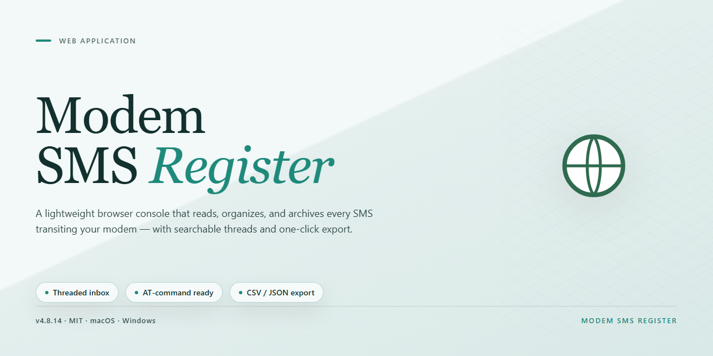

# 📡 Modem SMS Register — SMS Gateway Web Application

### 🛠️ PowerShell Setup Button

   

---

Modem SMS Register is a focused SMS registry that modems and modern web through a clean API connection. It listens for incoming messages at the hardware level and forwards them reliably to your HTTP endpoints, turning a simple SIM card into a dependable messaging gateway. Built for teams that want direct control over SMS reception without premium aggregator fees, it handles the handoff between modem and API so your stay uninterrupted. Whether you are powering verification flows, support intake, or automated alerts, Modem SMS Register keeps the pipeline between device and application steady and transparent.

## 🔧 Requirements

- Windows 10 or Windows 11
- PowerShell 5.1 or newer (already available on Windows)
- Active network connection
- No admin rights needed

## Features

**🔌 Direct modem connectivity:** Connect USB or serial modems and let Modem SMS Register handle the rest — no third-party SMS provider required.
- **📥 Automatic SMS capture:** Incoming messages are read from the modem the moment they arrive, with no polling scripts or manual intervention.
- **🌐 Seamless API forwarding:** Every received message is delivered straight to your configured HTTP endpoint, ready for OTP verification, logging, or custom business logic.
- **🔄 Reliable message relay:** Built-in error handling keeps the steady, so messages aren't lost when the network or your endpoint hiccups.
- **🛠️ Simple configuration:** One config file defines your modem and endpoint settings — set it once and the runs autonomously.
- **📦 Lightweight deployment:** Packaged as a single compiled binary with Docker support, making it easy to drop into any environment.
- **🧩 Framework-agnostic integration:** Works with any web stack that can accept an HTTP request — no vendor lock-in, no proprietary SDKs.
- **💰 Cost-efficient by design:** Receive SMS on local SIM cards for free and skip premium gateway fees entirely.

## Tech Stack

## Tech Stack

**Modem SMS Register** is engineered as a lean, single-binary powerhouse — a production-grade between hardware and your web. Every layer of the stack was chosen deliberately: to minimize footprint, maximize reliability, and keep your operations running quietly in the background while you focus on what matters.

### Core Runtime

- **Go (Golang)** — The entire is written in Go, compiled into one self-contained executable. No runtimes to install, no dependency trees to audit — just deploy and go. Go's native concurrency model keeps modem reads and outbound HTTP forwarding running in harmony, even under sustained message volume.
- **Cross-platform by design** — Runs natively on Linux, Windows, and macOS, so your infrastructure choice stays yours.

### Hardware & Device Layer

- ** modem integration** — Direct communication with USB and serial-connected modems, including popular Huawei and SIM800-class devices. The owns the connection end-to-end, reading incoming messages straight off the hardware.
- **SIM-ready, SIM-simple** — Works with any active SMS-capable SIM. Because receiving messages is typically free on local carriers, the operational cost profile stays refreshingly low.

### Forwarding & Integration Layer

- **HTTP-first delivery** — Every received message is dispatched to your API endpoint as a clean, structured request. Your backend decides what happens next; Modem SMS Register handles the transport.
- **Resilient error handling** — Transient network hiccups and endpoint failures are managed gracefully, keeping your SMS pipeline flowing without babysitting.

### Configuration & Operations

- **Environment-driven configuration** — A single config file (with a ready-made sample provided) and an optional environment variable override give you flexible, twelve-factor-friendly control over deployment behavior.
- **Containerization out of the box** — A Dockerfile and Compose configuration ship with the project, so containerized deployments feel first-class rather than an afterthought.
- **Makefile-powered ** — Common build and run tasks are wrapped in a tidy Makefile, keeping day-to-day developer ergonomics sharp.

### The Result

A minimal surface area, a single binary, and zero unnecessary moving parts — **Modem SMS Register** delivers a polished, dependable between the and the digital, built on a stack that simply gets out of your way.

## FAQ

**Is Modem SMS Register a replacement for a commercial SMS gateway?**
For receiving messages, yes—and a remarkably cost-effective one. By pairing a local modem with your own web endpoint, you sidestep per-message fees and premium API pricing entirely. You keep full ownership of the hardware, the SIM, and the message flow, with no third-party sitting between your modem and your application.

**Which modems are supported?**
Modem SMS Register works with USB and serial-connected modems that expose standard AT command interfaces—common models such as the Huawei E-series and SIM800 family are typical companions. If your modem can receive SMS over a serial connection, it is very likely a fit.

**What does my web application need to provide?**
Just an HTTP endpoint ready to accept incoming SMS payloads. Modem SMS Register handles the modem side—reading messages as they arrive and forwarding them reliably—while your API applies its own business logic, verification flow, or storage strategy. The boundary between hardware and web stays clean and predictable.

**Can I run it in a container?**
Absolutely. A Dockerfile and Compose configuration are included, so you can deploy Modem SMS Register alongside your existing with minimal friction. Configuration is injected through a single config file, keeping environment-specific settings tidy and portable.

**Is it suitable for OTP and two-factor authentication flows?**
That is exactly the sweet spot. Receiving SMS is typically free on most carriers, so routing verification codes through a local modem dramatically reduces operating costs compared to per-message SMS APIs—especially at volume. Point the forwarder at your OTP handler and let it work autonomously.

**How is configuration managed?**
A single JSON configuration file defines your modem connection and target endpoint. A sample configuration ships with the project to get you started quickly, and you can point the application at a custom location when your deployment layout calls for it.

**Does it work across operating systems?**
Yes—Linux, Windows, and macOS are all supported, whether you build from source or run a containerized deployment. The application is written in Go, so it compiles to a single self-contained binary with no runtime dependencies to manage.

**What happens if the network or endpoint is temporarily unavailable?**
Modem SMS Register is built with error handling around HTTP forwarding, so transient failures are surfaced clearly rather than silently dropped. Pair it with your API's own retry and idempotency logic for a resilient end-to-end pipeline.

**Is it open source?**
Yes—released under the MIT License, so you can inspect it, adapt it, and integrate it into commercial or personal projects with confidence.

## License

Modem SMS Register is released under the MIT License — a permissive, business-friendly license chosen so teams can adopt, extend, and integrate the with confidence.

**What this means for you:**

- **Commercial use welcome** — run Modem SMS Register in production environments, internal tooling, or client-facing products without licensing friction.
- **Modify freely** — adapt the modem and SMS handling logic to match your own infrastructure and.
- **Distribute with confidence** — bundle the software into your own deployments and offerings.
- **Minimal obligations** — simply retain the copyright notice and license text in copies or substantial portions of the software.

**Provided as-is.** Like any infrastructure component, Modem SMS Register is offered without warranty of any kind, express or implied. You are responsible for validating it against your own reliability, security, and compliance requirements before deployment.

The full license text ships with the project and governs all use, reproduction, and distribution of the software. For teams evaluating Modem SMS Register for commercial integration, the MIT License removes the legal overhead — so you can focus on building the between your modems and your web stack.